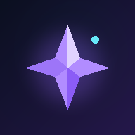

# BYOK — Your AI. Your Keys. Your Knowledge.

<div align="center">



### A Private, Local-First AI Chat & Markdown Workspace

[](LICENSE)
[](https://localfirstweb.dev/)
[](https://developer.mozilla.org/en-US/docs/Web/API/File_System_Access_API)
[](manifest.json)
[](https://developer.mozilla.org/en-US/docs/Web/API/SubtleCrypto)
[](https://webassembly.org/)

**BYOK** is an ultra-fast, zero-backend, single-file AI workspace that runs entirely in your browser. Connect directly to state-of-the-art AI models using your own API keys, save your conversations and notes as plain Markdown files into a local Obsidian-compatible vault, and convert complex documents client-side using WebAssembly—all with complete privacy.

[Features](#-key-features) • [Supported Providers](#-supported-providers) • [Getting Started](#-getting-started) • [Storage Architecture](#-storage-architecture) • [Security & Privacy](#-security--privacy) • [PWA & Mobile](#-pwa--mobile-experience)

</div>

---

## 🌟 Why BYOK?

Most modern AI clients route your sensitive prompts, proprietary documents, and API credentials through an intermediary server. **BYOK eliminates the middleman entirely**:

- 🔒 **Zero Middleman Servers**: Every API call goes directly from your browser to OpenAI, Anthropic, Google, OpenRouter, or your local Ollama server.
- 📂 **Own Your Data**: Chat sessions, prompts, notes, and attachment metadata are saved as clean Markdown files (`.md`) formatted with Obsidian-compatible YAML frontmatter.
- ⚡ **Zero Installation & Single File**: The entire application runs from a standalone `index.html` file—no build pipeline, Node.js runtime, or Docker containers required.
- 🛡️ **Hardware-Grade Cryptography**: Your API keys never touch unencrypted storage; they are safeguarded via **Web Crypto AES-256-GCM** managed strictly within your browser profile.

---

## ✨ Key Features

### 🤖 Multi-Provider & Local Model Integration
Switch effortlessly between industry-leading cloud LLMs and local offline models. BYOK automatically fetches provider model catalogs and lets you fine-tune system prompts, temperatures, and generation parameters.

### 📑 Obsidian-Compatible Vault
Connect directly to any local folder on your computer or mobile device using the **File System Access API**. Chats and notes are automatically structured:
- `Chats/` — Full conversations with structured timestamps and model metadata.
- `Notes/` — Standalone Markdown notes with live preview and rich formatting.
- `Attachments/` — Extracted text and document context.
- `.trash/` — Soft-delete safety net for easy restoration.

### 🧩 Local Document Parsing with WebAssembly (AnyDoc WASM)
Attach and parse documents directly in your browser using a client-side WebAssembly worker (`@firecrawl/anydoc-wasm`). No files are uploaded to external parsing services. Supported formats include:
- **PDF & eBooks**: `.pdf`, `.epub`
- **Microsoft Office**: `.docx`, `.doc`, `.pptx`, `.ppt`, `.xlsx`, `.xls`
- **OpenDocument**: `.odt`, `.odp`, `.ods`
- **Text & Data**: `.txt`, `.md`, `.rtf`, `.csv`, `.json`, `.html`, `.htm`

### 🎨 Fluid, Gemini-Inspired Clean UI
- **Rich Document Rendering**: Pinned versions of **Marked** with strict **DOMPurify** sanitization.
- **Code Highlighting**: Syntax highlighting for dozens of programming languages via **Highlight.js** with one-click code copy buttons.
- **LaTeX Math Rendering**: Beautiful inline and block math support powered by **KaTeX**.
- **Reader Mode**: Distraction-free reading experience that automatically tucks chrome away during long responses.

### 📱 Haptic & Audio Feedback
Experience native-feeling tactile interactions:
- Synthesized mechanical click and notification sounds via the **Web Audio API**.
- Multi-cadence vibration haptics on supported mobile devices.
- Subtle scroll-tick feedback for precision reading.

---

## 🔌 Supported Providers

| Provider | Supported Models | Endpoint Type | Docs |
| :--- | :--- | :--- | :--- |
| **OpenAI** | GPT-4o, GPT-4o-mini, o1, o3-mini, GPT-4-turbo | Direct Cloud | [OpenAI Keys](https://platform.openai.com/api-keys) |
| **Google Gemini** | Gemini 2.0 Flash, Gemini 1.5 Pro, Gemini 1.5 Flash | Direct Cloud | [Google AI Studio](https://aistudio.google.com/app/apikey) |
| **Anthropic** | Claude 3.5 Sonnet, Claude 3.5 Haiku, Claude 3 Opus | Direct Cloud | [Anthropic Console](https://console.anthropic.com/settings/keys) |
| **OpenRouter** | DeepSeek R1/V3, Llama 3.3, Mistral, Qwen, +100s | Direct Cloud | [OpenRouter Keys](https://openrouter.ai/keys) |
| **Custom / Local** | Ollama, LM Studio, vLLM, llama.cpp, LocalAI | Local / Custom URL | OpenAI-compatible `/v1` |

> [!TIP]
> **Running Local Models**: To use Ollama or LM Studio, select **Custom OpenAI-compatible** in *Models & Providers*, set your endpoint (e.g., `http://localhost:11434/v1` for Ollama), and enter your model tag. Ensure CORS is enabled on your local server.

---

## 🚀 Getting Started

Because BYOK is built with vanilla web technologies, you can launch it in seconds:

### Method 1: Local HTTP Server (Recommended)
Due to browser security policies regarding Web Workers and WebAssembly, launch BYOK using any local HTTP server:

```bash
# Using Python 3
python -m http.server 8080

# Using Node.js (npx)
npx serve .

# Using PHP
php -S localhost:8080
```
Open your browser to `http://localhost:8080`.

### Method 2: Static Hosting / Cloud Deployments
Deploy your private copy to any static web host in under a minute:
- **GitHub Pages**: Push this directory to a GitHub repository and turn on Pages in repository settings.
- **Vercel / Cloudflare Pages / Netlify**: Simply drag and drop the folder or point to the repository.

### Method 3: Install as a Progressive Web App (PWA)
1. Open the application in **Chrome**, **Edge**, **Brave**, or **Safari** on desktop or mobile.
2. Click the **Install** button in your browser's address bar or select **Add to Home Screen** from the share menu.
3. Launch BYOK as a standalone, windowed app with full offline capabilities.

---

## 🗄️ Storage Architecture

BYOK adapts to the capabilities of your current device and browser:

```
┌────────────────────────────────────────────────────────┐
│                      BYOK Core                         │
└────────┬──────────────────────┬───────────────────────┬┘
         │                      │                       │
         ▼                      ▼                       ▼
┌──────────────────┐  ┌──────────────────┐  ┌──────────────────┐
│ File System API  │  │    OPFS Vault    │  │ IndexedDB Backup │
│ (Chromium / PC)  │  │ (Private Browser)│  │ (Fallback Store) │
├──────────────────┤  ├──────────────────┤  ├──────────────────┤
│ Direct folder on │  │ High-performance │  │ Stores chats and │
│ disk. Instant    │  │ sandboxed browser│  │ keys when no disk│
│ sync with your   │  │ filesystem. Zero │  │ permission is    │
│ Obsidian vault.  │  │ prompt popups.   │  │ granted.         │
└──────────────────┘  └──────────────────┘  └──────────────────┘
```

- **Direct File System Access (`showDirectoryPicker`)**: Seamlessly mounts an existing directory on your machine (like your existing Obsidian vault).
- **Origin Private File System (OPFS)**: A private, fast virtual file system isolated to your browser profile.
- **ZIP Import & Export**: One-click archive download and restore for browsers that don't support direct directory access (e.g. mobile Safari).

---

## 🔐 Security & Privacy

| Area | Implementation |
| :--- | :--- |
| **API Keys** | Encrypted client-side using `AES-GCM-256` via the Web Crypto API. Cryptographic keys are held in browser-isolated IndexedDB and never sent over the network. |
| **Network Requests** | Direct browser-to-provider HTTP/HTTPS fetch calls with streaming (`ReadableStream`). No intermediate proxy, telemetry, or analytics server. |
| **File Processing** | AnyDoc WebAssembly runs inside an isolated web worker (`Worker`) without leaving your machine. |
| **Content Sanitization** | All rendered Markdown is strictly cleansed through `DOMPurify` to safeguard against Cross-Site Scripting (XSS). |

---

## 📁 Vault File Format

Every note and conversation saved to your vault remains readable in any standard text editor or Markdown knowledge base:

```markdown
---
byok_type: chat
schema_version: 1
id: "c-1731135600-a1b2c"
title: "Deep Dive into Distributed Systems"
folder: "Chats"
provider: "anthropic"
model: "claude-3-5-sonnet"
system_prompt: "You are an expert distributed systems engineer."
created_at: "2026-11-09T10:30:00.000Z"
updated_at: "2026-11-09T10:35:12.000Z"
favorite: true
deleted: false
---

# Deep Dive into Distributed Systems

**User:**
Explain the consensus problem in asynchronous networks.

**Assistant:**
The consensus problem centers on achieving agreement among distributed nodes...
```

---

## 📱 PWA & Mobile Experience

- **Safe-area insets**: Native handling of notches, navigation pills, and dynamic viewports (`100dvh`).
- **Touch-optimized**: Android/iOS-style bottom navigation and long-press contextual menus.
- **Offline Shell**: UI and rendering libraries cache for instant launch even without an active internet connection.

---

## 🛠️ Tech Stack & Dependencies

- **HTML5 & Modern CSS**: Grid, CSS variables, backdrop filters, responsive viewport units.
- **JavaScript (ES Modules)**: Vanilla JS, zero build steps, zero bundle overhead.
- **[Marked.js](https://marked.js.org/)**: Markdown parsing.
- **[DOMPurify](https://github.com/cure53/DOMPurify)**: Security sanitization.
- **[Highlight.js](https://highlightjs.org/)**: Code syntax highlighting.
- **[KaTeX](https://katex.org/)**: Fast math rendering.
- **[Lucide Icons](https://lucide.dev/)**: Clean icon set.
- **[JSZip](https://stuk.github.io/jszip/)**: Portable folder zip export & import.
- **[@firecrawl/anydoc-wasm](https://github.com/firecrawl/anydoc)**: In-browser WebAssembly document conversion.

---

## 📄 License

This project is open-source under the [MIT License](LICENSE).

---

<div align="center">
<b>Your AI. Your Keys. Your Knowledge.</b><br>
Built for individuals who value privacy, sovereignty, and clean software.
</div>

